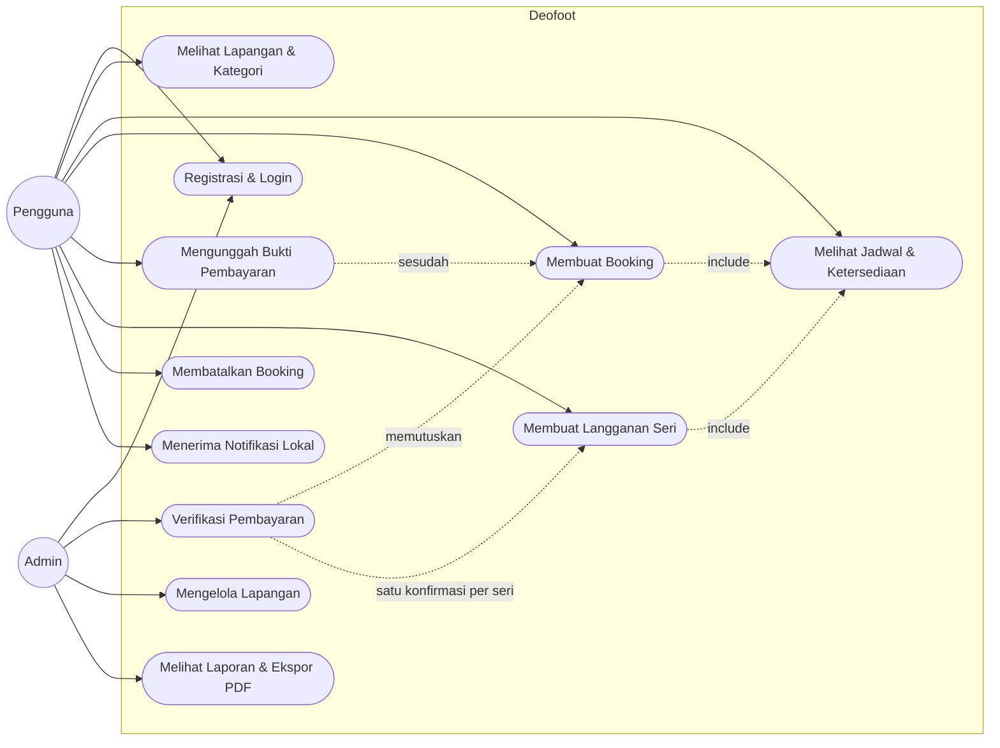
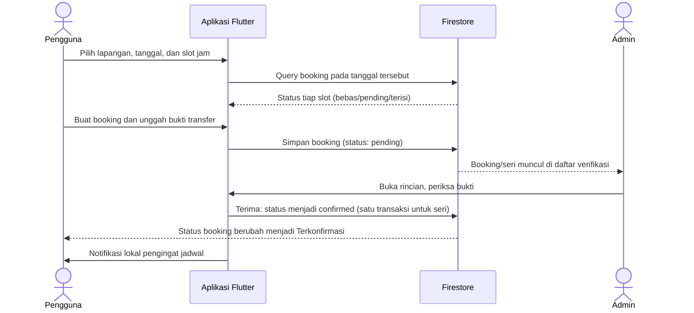
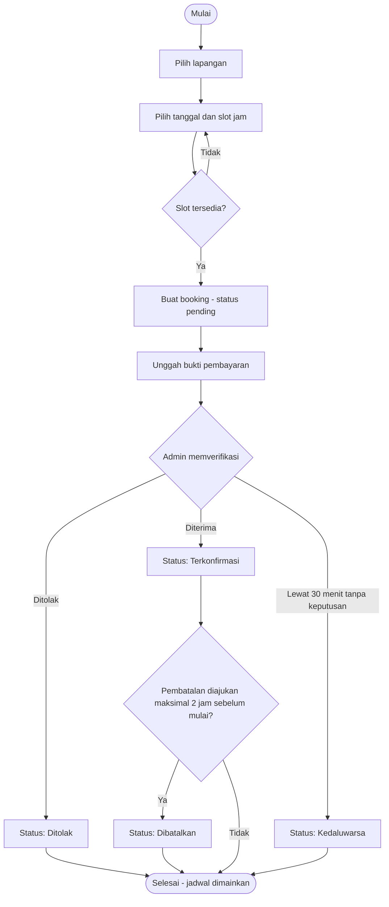

# Deofoot — Aplikasi Mobile Booking Lapangan Olahraga

📚 **Tugas Mata Kuliah: Analisis & Pengujian Sistem IF7K**
Mata Kuliah: Analisis & Pengujian Sistem
Ketua Kelompok: Azkal Azkia-212221010
Anggota:
- — (pengerjaan individu)

---

## 📝 Deskripsi Proyek (20 poin)

Repositori ini berisi artefak, dokumen, dan kode yang berkaitan dengan tugas mata kuliah Analisis & Pengujian Sistem. Proyek ini bertujuan untuk menganalisis kebutuhan, merancang arsitektur, dan mengimplementasikan pengujian fungsional untuk **Deofoot**, sebuah aplikasi mobile pemesanan (booking) lapangan olahraga.

Deofoot melayani pemesanan 11 lapangan dalam 4 kategori — Futsal (3 lapangan, Rp120.000/jam), Padel (2 lapangan, Rp250.000/jam), Tenis (3 lapangan, Rp150.000/jam), dan Mini Soccer (3 lapangan, Rp300.000/jam) — dengan slot 60 menit pada jam operasional 08.00–22.00 dan cakrawala pemesanan 90 hari. Pengguna memilih lapangan dan jadwal, membuat booking, membayar manual melalui transfer DANA, lalu mengunggah bukti pembayaran; booking berstatus *pending* dan hanya berlaku setelah diverifikasi oleh satu akun admin. Sistem mencegah pemesanan ganda (double booking) pada slot yang tumpang tindih, mendukung langganan slot rutin mingguan (satu seri, satu pembayaran, satu konfirmasi admin untuk seluruh seri), pembatalan maksimal 2 jam sebelum mulai, notifikasi lokal, serta laporan admin dengan ekspor PDF.

Fokus mata kuliah pada proyek ini adalah pengujian sistematis: rencana pengujian, desain test case, evaluasi kualitas ISO/IEC 25010, serta system, acceptance, dan regression testing — seluruhnya terdokumentasi di folder [`pengujian/`](pengujian/).

## 📝 Desain Proyek (Unified Modeling Language) (20 poin)

### Use Case Diagram

Aktor **Pengguna** melakukan seluruh alur pemesanan; aktor **Admin** (satu akun khusus dengan penanda `isAdmin`) melakukan verifikasi pembayaran — per booking individual, atau satu kali untuk satu seri langganan — mengelola ketersediaan lapangan, dan menarik laporan.

### Sequence Diagram — Alur Booking sampai Terkonfirmasi

### Activity Diagram — Alur Booking

## 📝 Arsitektur Proyek (Unified Modeling Language) (20 poin)

Arsitektur Deofoot adalah **client–server tanpa server khusus (serverless)**:

- **Lapisan presentasi (Flutter)** — layar-layar aplikasi (Beranda, Jadwal, Booking, Booking Saya, Langganan, Verifikasi, Laporan, Kelola Lapangan, Profil) dibangun di atas komponen desain dan sistem gerak yang seragam. Seluruh keputusan tampilan dipisahkan dari logika bisnis.
- **Lapisan logika murni (Dart)** — fungsi-fungsi murni tanpa efek samping yang memuat aturan bisnis: ketersediaan slot dan deteksi tumpang tindih, status slot, rentang tanggal pemesanan (90 hari), semantik seri langganan, perhitungan laporan, dan aturan verifikasi. Lapisan inilah yang menjadi objek utama unit test.
- **Lapisan layanan (Firestore Service)** — satu-satunya jalur baca/tulis ke basis data, termasuk stream status booking dan perubahan status seri secara atomik dalam satu transaksi.
- **Backend Firebase** — *Authentication* (email/kata sandi dan Google) untuk identitas, *Cloud Firestore* (region asia-southeast1) untuk data lapangan, booking, seri langganan, dan konfigurasi pembayaran. **Firestore Security Rules** menjadi lapisan otorisasi: pengguna biasa tidak dapat membuat dirinya admin, booking selalu lahir berstatus pending, dan hanya admin yang dapat mengubah status verifikasi.
- **Layanan perangkat** — notifikasi lokal untuk pengingat jadwal dan pembuatan PDF untuk laporan admin, keduanya berjalan di perangkat tanpa server tambahan.

Pemisahan ini membuat aturan bisnis dapat diuji secara unit tanpa emulator maupun jaringan, sementara aturan keamanan ditegakkan di sisi server oleh security rules — bukan hanya oleh tampilan aplikasi.

## 📝 Tech Stack (20 poin)

| Lapisan | Teknologi |
|---|---|
| FE (Frontend) | Flutter 3.x / Dart — aplikasi Android, desain "Pitch" (Plus Jakarta Sans) |
| BE (Backend) | Firebase (serverless) — Authentication & Cloud Firestore |
| Database | Cloud Firestore (NoSQL, region asia-southeast1) |
| Service | Firebase Auth (Email/Password & Google Sign-In), Firestore Security Rules |
| Layanan lokal | flutter_local_notifications (pengingat), pdf & printing (laporan PDF) |
| Pengujian | flutter_test (unit & widget test) — 170 test otomatis |
| Manajemen kode | Git & GitHub |

## 📂 Dokumentasi Pengujian

- [Rencana Pengujian](pengujian/01-rencana-pengujian.md) — Perencanaan & monitoring pengujian (Pertemuan 3)
- [Desain Test Case](pengujian/02-desain-test-case.md) — Format Slide 14, equivalence partitioning & boundary value (Pertemuan 4)
- [Evaluasi Kualitas ISO/IEC 25010](pengujian/03-evaluasi-iso-25010.md) — Penilaian per karakteristik (Pertemuan 6)
- [System, Acceptance & Regression Testing](pengujian/04-system-acceptance-regression.md) — Termasuk klasifikasi test case obsolete & redundant (Pertemuan 7)
- [Naskah Simulasi Demo](pengujian/05-naskah-simulasi-demo.md) — Skenario demonstrasi saat UTS

## 🚀 Menjalankan Aplikasi

1. `flutter pub get`
2. `flutter run` (perangkat Android / emulator, min. API 34 untuk pengujian kami)
3. Masuk dengan akun terdaftar; fitur admin hanya muncul pada akun berpenanda `isAdmin`.

## Static Code Analysis (SonarQube Cloud) (Pertemuan 13)

Analisis statis berjalan otomatis lewat GitHub Actions ([workflow SonarQube](.github/workflows/sonarqube.yml)) pada setiap push ke cabang `fitur/sonarqube-p13`. Hasilnya tampil di [dashboard SonarCloud](https://sonarcloud.io/project/overview?id=ayyubi06_final-deofoot-analisispengujiansistem-uts). Menjalankan ulang scan: push commit baru ke cabang tersebut atau jalankan ulang workflow dari tab Actions.
